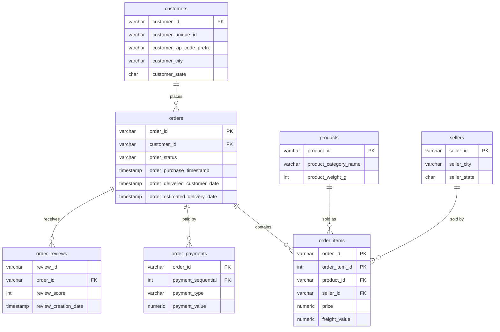

# Olist E-commerce Analysis

## Project goal
Analyse ~100k real orders from Olist, a Brazilian e-commerce marketplace, the way a business analyst would: load the data into PostgreSQL, check its quality, then answer business questions with SQL and Python (revenue trends, delivery performance, review scores, customer retention).

**Status:** Week 1 complete (database built and data validated). Business analysis is next.

## Dataset
[Brazilian E-Commerce Public Dataset by Olist](https://www.kaggle.com/datasets/olistbr/brazilian-ecommerce) (Kaggle). 9 related tables, orders from 2016 to 2018. The CSV files are not in this repo; download them from Kaggle.

| Table | Rows |
|---|---|
| customers | 99,441 |
| orders | 99,441 |
| order_items | 112,650 |
| order_payments | 103,886 |
| order_reviews | 99,224 |
| products | 32,951 |
| sellers | 3,095 |
| geolocation | 1,000,163 |
| product_category_translation | 71 |

## Schema

`geolocation` (zip code to latitude/longitude) and `product_category_translation` (Portuguese to English category names) have no foreign keys. They are joined by zip code and category name in queries.

## How to reproduce
1. Install PostgreSQL and a client such as DBeaver. Create a database named `olist`.
2. Run `sql/01_create_tables.sql`.
3. Import each Kaggle CSV into its table. Use `order_reviews` with line breaks inside comments replaced by spaces, because many tools split those rows.
4. Run `sql/02_data_quality_checks.sql` and compare with the findings below.

## Data quality findings
- **Unique keys:** no duplicate order IDs, and every order links to a valid customer.
- **Dates:** no order has a delivery date earlier than its purchase date.
- **Missing delivery dates:** 2,965 orders have none. 2,957 are explained by status (cancelled, unavailable, still in progress). 8 are marked `delivered` with no date, so I exclude them from delivery-time analysis.
- **Orders with no items:** 775. 772 are unavailable, cancelled or just created, which is expected. 3 (1 shipped, 2 invoiced) were placed on 5 Oct 2016 and look like early data gaps. They add no revenue, so I use LEFT JOINs when order counts matter.
- **Product categories:** 610 products (about 1.9%) have no category. They were imported as empty strings, which `IS NULL` misses, so I converted them to NULL.
- **Review comments:** some contain line breaks, quotes and backslashes that break CSV imports. I cleaned these in the comment columns before loading.

## Next
Revenue and growth analysis, delivery performance vs. review scores, repeat-purchase and cohort retention, RFM customer segmentation.
